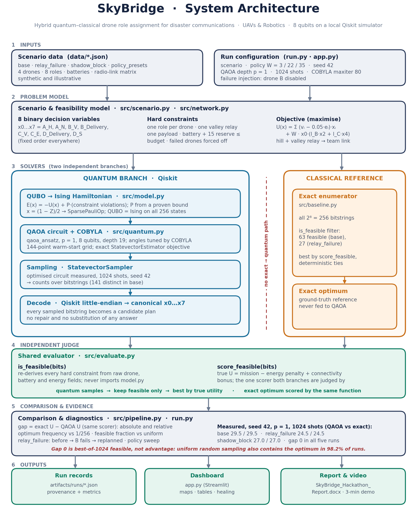

# SkyBridge

**Hybrid quantum–classical drone role assignment for disaster communications.**
Domain: **UAVs & Robotics** · Qiskit Fall Fest 2026 Quantum Optimization Challenge

After a disaster cuts ground communications, a command operator must decide what each of four battery-limited drones does. A rescue team on the ground can talk to base only if one drone holds a **hill relay** *and* another holds a **valley relay**. Every drone used as a relay is a drone not doing reconnaissance or delivering supplies. SkyBridge formulates this trade-off as an 8-variable binary optimisation, solves it with **QAOA in Qiskit**, and checks every answer against an **independent exact enumeration of all 256 plans**.

> The data are synthetic and illustrative. SkyBridge is a research prototype, not a flight controller, radio planner, or rescue decision system. No quantum speedup is claimed.



The editable source of this diagram is [`artifacts/figures/architecture.drawio.svg`](artifacts/figures/architecture.drawio.svg); open it at <https://app.diagrams.net> (File → Open from → Device).

---

## Contents

1. [The problem in one page](#1-the-problem-in-one-page)
2. [Prerequisites](#2-prerequisites)
3. [Installation](#3-installation)
4. [Verify the installation (tests)](#4-verify-the-installation-tests)
5. [Run the optimiser](#5-run-the-optimiser)
6. [Read the output](#6-read-the-output)
7. [Launch the dashboard](#7-launch-the-dashboard)
8. [Regenerate the report and run submission checks](#8-regenerate-the-report-and-run-submission-checks)
9. [Full reproduction script](#9-full-reproduction-script)
10. [Repository layout](#10-repository-layout)
11. [How it works](#11-how-it-works)
12. [Results](#12-results)
13. [Limitations](#13-limitations)
14. [Troubleshooting](#14-troubleshooting)
15. [Team and attribution](#15-team-and-attribution)

---

## 1. The problem in one page

**Decision variables.** Eight binary choices, always in this fixed order:

| Bit | Name | Drone | Role | Utility v | Energy e |
|---|---|---|---|---|---|
| x0 | `A_H` | A | hill relay | 1 | 40 |
| x1 | `A_N` | A | north recon | 8 | 30 |
| x2 | `B_V` | B | primary valley relay | 1 | 35 |
| x3 | `B_Delivery` | B | medical supplies | 6 | 45 |
| x4 | `C_V` | C | alternate valley relay | 1 | 30 |
| x5 | `C_E` | C | east recon | 7 | 35 |
| x6 | `D_Delivery` | D | emergency supplies | 6 | 40 |
| x7 | `D_S` | D | south recon | 4 | 25 |

Battery budgets: A 85, B 80, C 60, D 55. Emergency reserve: 15.

**Objective (maximise).**

```
U(x) = Σ (v_i − α·e_i)·x_i  +  W · x0 · (l_B·x2 + l_C·x4)
```

`α = 0.05` is the energy cost weight, `W` is the value of connecting the rescue team, and `l_B`, `l_C` are 1 when the hill-to-valley radio link exists. The connectivity term is **quadratic**: it pays only when the hill relay *and* a valley relay are both chosen.

**Hard constraints.**
- At most one role per drone.
- At most one valley relay (`x2 + x4 ≤ 1`).
- At most one payload delivery (`x3 + x6 ≤ 1`).
- Role energy plus the 15-unit reserve must not exceed the drone's battery.
- A failed drone's roles are forced off.

A missing radio link does **not** make a plan infeasible; it only removes the connectivity bonus.

**Scenarios and policies.**

| Scenario | What changes |
|---|---|
| `base` | Normal conditions |
| `relay_failure` | Drone B is disabled; the plan must self-heal |
| `shadow_block` | Terrain blocks the hill ↔ valley-B link |

| Policy | W | Meaning |
|---|---|---|
| `mission_first` | 3 | Missions matter most; relays rarely worth it |
| `balanced` | 22 | Default trade-off |
| `coverage_first` | 35 | Connecting the team matters most |

---

## 2. Prerequisites

| Requirement | Version | Notes |
|---|---|---|
| Python | **3.11** (tested on 3.11.9) | The pinned wheels do not all exist for 3.12+ |
| Git | any recent | To clone the repository |
| OS | Windows 10/11, macOS, Linux | Tested on Windows 11 |
| IBM Quantum account | **not needed** | Everything runs on the local Qiskit statevector simulator |
| Disk / RAM | ~1 GB / 2 GB | Mostly the Qiskit, SciPy and Streamlit wheels |

Check your Python version:

```bash
python3.11 --version        # macOS / Linux
py -3.11 --version          # Windows
```

If Python 3.11 is missing, install it from <https://www.python.org/downloads/> (Windows/macOS) or your package manager (`sudo apt install python3.11 python3.11-venv` on Ubuntu).

---

## 3. Installation

### Windows (PowerShell)

```powershell
git clone https://github.com/Muhammad-Ismail-24/SkyBridge.git
cd SkyBridge
py -3.11 -m venv .venv
.\.venv\Scripts\python.exe -m pip install --upgrade pip
.\.venv\Scripts\python.exe -m pip install -r requirements.txt
```

### macOS / Linux

```bash
git clone https://github.com/Muhammad-Ismail-24/SkyBridge.git
cd SkyBridge
python3.11 -m venv .venv
.venv/bin/python -m pip install --upgrade pip
.venv/bin/python -m pip install -r requirements.txt
```

Optionally activate the environment so `python` and `streamlit` refer to it:

```powershell
.\.venv\Scripts\Activate.ps1      # Windows PowerShell
```

```bash
source .venv/bin/activate         # macOS / Linux
```

**All commands below assume the virtual environment is active and you are in the repository root.** If you do not activate it, replace `python` with `.\.venv\Scripts\python.exe` (Windows) or `.venv/bin/python` (macOS/Linux).

Confirm the pinned stack installed correctly:

```bash
python -c "import sys, qiskit, numpy, scipy; print(sys.version.split()[0], 'qiskit', qiskit.__version__, 'numpy', numpy.__version__, 'scipy', scipy.__version__)"
```

Expected: `3.11.x qiskit 2.6.2 numpy 2.4.6 scipy 1.17.1`.

Pinned dependencies (`requirements.txt`): `qiskit==2.6.2`, `numpy==2.4.6`, `scipy==1.17.1`, `rustworkx==0.18.1`, `pytest==9.2.0`, `streamlit==1.67.0`, `python-docx==1.2.0`.

---

## 4. Verify the installation (tests)

```bash
python -m pytest tests -q
```

Expected: **192 passed** in about 20 seconds. The suite covers:

| Test file | What it proves |
|---|---|
| `tests/test_model.py` | QUBO and Ising energies agree on all 256 states; penalty is large enough; bit order is correct |
| `tests/test_exact.py` | The exact enumerator finds the true optimum and handles ties |
| `tests/test_constraints.py` | `is_feasible` matches a hand-written brute force on every scenario and policy |
| `tests/test_network.py` | The connectivity term matches the radio-link matrix |
| `tests/test_pipeline.py` | The pipeline never substitutes the exact answer for a quantum result; JSON contract |
| `tests/test_dashboard.py` | The dashboard loads every saved run without errors |

Repository structure gate:

```bash
python scripts/verify_structure.py --phase tracked --strict
```

Expected: `SKYBRIDGE STRUCTURE CHECK: PASS`.

---

## 5. Run the optimiser

Each command runs one **real** Qiskit QAOA solve plus the exact 256-state baseline, prints a summary, and saves a JSON run record to `artifacts/runs/`. A run takes about 3–5 seconds.

```bash
# Normal conditions, balanced policy
python run.py --scenario base --policy balanced --seed 42

# Drone B fails: shows before / immediately after failure / replanned
python run.py --scenario relay_failure --policy balanced --seed 42

# Terrain blocks the hill <-> valley-B radio link
python run.py --scenario shadow_block --policy balanced --seed 42

# Same drones, different priorities
python run.py --scenario base --policy mission_first --seed 42
python run.py --scenario base --policy coverage_first --seed 42
```

### Command-line options

| Option | Default | Meaning |
|---|---|---|
| `--scenario` | `base` | `base`, `relay_failure` or `shadow_block` |
| `--policy` | `balanced` | `mission_first` (W=3), `balanced` (W=22), `coverage_first` (W=35) |
| `--seed` | `42` | Random seed for the sampler |
| `--shots` | `1024` | Number of samples drawn from the optimised circuit |
| `--reps` | `1` | QAOA depth p |
| `--maxiter` | `80` | Maximum COBYLA function evaluations |
| `--no-write` | off | Run and print without overwriting the saved JSON |
| `--policy-sweep` | off | Solve all three policies for one scenario and print a comparison table |
| `--from-saved` | off | With `--policy-sweep`: rebuild the table from saved files without solving |

Useful variants:

```bash
# Try it without touching the committed results
python run.py --scenario base --policy balanced --seed 42 --no-write

# Compare the three policies from the saved run files (no new solve)
python run.py --policy-sweep --scenario base --seed 42 --from-saved
```

### Output files

| Run | File |
|---|---|
| balanced policy, seed 42 | `artifacts/runs/<scenario>.json` |
| any other policy or seed | `artifacts/runs/<scenario>__<policy>__seed<N>.json` |

---

## 6. Read the output

Example: `python run.py --scenario base --policy balanced --seed 42 --no-write`

```
QUANTUM  ran_qiskit=True status=feasible_found backend=qiskit.primitives.StatevectorSampler
         shots=1024 reps=1 optimizer_iterations=32
         feasible_sample_fraction=0.8505859375 distinct_bitstrings=141
         best_feasible=10100110  (A_H, B_V, C_E, D_Delivery)  U=29.5
EXACT    best=10100110  (A_H, B_V, C_E, D_Delivery)  U=29.5
         enumerated=256 feasible=63 infeasible=193
GAP      absolute=0.0 relative_pct=0.0
DIAG     most frequent sample [1, 0, 0, 0, 1, 0, 0, 1] count=37 feasible=True utility=23.25
         optimum frequency 0.0126953125 vs uniform per-shot rate 0.003906
CHECKS   all true
```

| Line | Meaning |
|---|---|
| `ran_qiskit=True` | A real Qiskit circuit was built, optimised and sampled |
| `feasible_sample_fraction` | Share of the 1024 samples that satisfy every hard constraint (uniform random: 0.246) |
| `best_feasible` | Highest-utility **feasible** sample, bits printed as x0…x7 |
| `EXACT best` | True optimum from checking all 256 plans |
| `GAP` | Exact utility minus QAOA utility, both scored by the same function |
| `DIAG` | How often QAOA actually produced the optimum, compared with random guessing (1/256) |
| `CHECKS all true` | Both plans re-checked against the independent feasibility test |

The saved JSON contains everything above plus `quantum.diagnostics`, `comparison.interpretation`, the circuit depth, optimal angles, penalty derivation, software versions and timestamp. For `relay_failure`, the `healing` key holds the three-stage self-healing trace.

---

## 7. Launch the dashboard

```bash
streamlit run app.py
```

If `streamlit` is not on your `PATH`, use `.\.venv\Scripts\streamlit.exe run app.py` (Windows) or `.venv/bin/streamlit run app.py` (macOS/Linux).

Open <http://localhost:8501>. The dashboard is a **read-only viewer of the saved run files** in `artifacts/runs/`; it never re-runs QAOA. Pick a run from the **Recorded scenario** dropdown:

| Dashboard section | Shows |
|---|---|
| Headline metrics | QAOA best utility, exact optimum, absolute and relative gap, whether the rescue team is connected |
| Mission assignments | Each drone's role, battery budget and remaining charge |
| Quantum and exact comparison | Both plans as bits with mission score, energy penalty and connectivity bonus |
| Interpretation box | Why a zero gap is not evidence of quantum advantage |
| Communication network | Radio map; green = reachable from base, amber = active but cut off, grey = unused link, red dashed = failed drone |
| Relay Failure only | Three maps: normal → B fails (no replan) → re-optimised |
| Run provenance | Seed, timestamp, circuit depth, penalty, versions, source file |

Stop the server with `Ctrl+C`.

---

## 8. Regenerate the report and run submission checks

```bash
python scripts/generate_report.py
python scripts/verify_submission.py
```

`generate_report.py` rebuilds `report/SkyBridge_Hackathon_Report.docx` from the saved JSON run records and the architecture figure. `verify_submission.py` checks structural and artifact readiness. Public links, the demo video and the organiser form still need a human check.

---

## 9. Full reproduction script

From a fresh clone, the whole system can be reproduced with these commands (macOS/Linux shown; on Windows use `py -3.11` and `.\.venv\Scripts\python.exe`):

```bash
git clone https://github.com/Muhammad-Ismail-24/SkyBridge.git
cd SkyBridge
python3.11 -m venv .venv
source .venv/bin/activate
python -m pip install -r requirements.txt

python -m pytest tests -q                                    # 192 passed
python scripts/verify_structure.py --phase tracked --strict  # PASS

python run.py --scenario base           --policy balanced       --seed 42
python run.py --scenario relay_failure  --policy balanced       --seed 42
python run.py --scenario shadow_block   --policy balanced       --seed 42
python run.py --scenario base           --policy mission_first  --seed 42
python run.py --scenario base           --policy coverage_first --seed 42
python run.py --policy-sweep --scenario base --seed 42 --from-saved

python scripts/generate_report.py
streamlit run app.py
```

With seed 42 the regenerated JSON files reproduce the committed best plans, utilities, feasible fractions and optimum frequencies. Timings vary between machines.

---

## 10. Repository layout

```
SkyBridge/
├── run.py                     # Command-line entry point
├── app.py                     # Streamlit dashboard (reads artifacts/runs/*.json)
├── requirements.txt           # Pinned Python 3.11 dependencies
├── data/
│   ├── base.json              # Drones, roles, batteries, links (synthetic)
│   ├── relay_failure.json     # Drone B disabled
│   └── policy_presets.json    # W for mission_first / balanced / coverage_first
├── src/
│   ├── scenario.py            # Load and validate a scenario + policy
│   ├── network.py             # Radio links and connectivity term
│   ├── evaluate.py            # is_feasible / score_feasible: the independent judge
│   ├── model.py               # QUBO, penalty proof, Ising Hamiltonian, bit order
│   ├── quantum.py             # Qiskit QAOA: circuit, COBYLA, StatevectorSampler
│   ├── baseline.py            # Exact 256-state enumeration
│   └── pipeline.py            # Runs both branches, judges, compares, writes JSON
├── tests/                     # 192 pytest tests
├── scripts/
│   ├── generate_report.py     # Builds the DOCX report from run records
│   ├── verify_structure.py    # Repository structure gate
│   └── verify_submission.py   # Submission readiness check
├── artifacts/
│   ├── runs/                  # Saved JSON run records (real run.py output)
│   ├── figures/               # Architecture diagram (PNG, SVG, draw.io)
│   └── COMPLETION_REPORT.md   # Verification log
├── report/
│   └── SkyBridge_Hackathon_Report.docx
└── architecture.md            # Full technical specification
```

---

## 11. How it works

1. **Scenario model** (`src/scenario.py`, `src/network.py`). Loads drones, roles, batteries and the radio-link matrix, applies the chosen policy weight W and any failed drones.
2. **QUBO** (`src/model.py`). Rewrites the problem as minimising `E(x) = −U(x) + P · (constraint violations)`. The penalty `P` is derived from a single-flip bound, so every infeasible plan has a strictly better feasible neighbour (P = 45 for base, balanced; the derivation is stored in every JSON).
3. **Ising Hamiltonian** (`src/model.py`). Substitutes `x_i = (1 − Z_i)/2` to obtain a Qiskit `SparsePauliOp`. A test checks that QUBO and Ising energies agree on all 256 states. Qiskit is little-endian; the conversion between Qiskit bitstrings and the canonical `x0…x7` order happens only in `src/model.py`.
4. **QAOA** (`src/quantum.py`). Builds `qaoa_ansatz` with p = 1 on 8 qubits (depth 19 after expanding RZZ gates). A 144-point (γ, β) grid scan picks a warm start, then SciPy COBYLA minimises the expected energy computed by `StatevectorEstimator`.
5. **Sampling** (`src/quantum.py`). The optimised circuit is measured 1024 times with `StatevectorSampler` (seed 42).
6. **Judging** (`src/pipeline.py`, `src/evaluate.py`). Each sampled bitstring is decoded and checked with `is_feasible`, which re-derives every constraint from the raw data and never imports `model.py`. Feasible samples are scored with `score_feasible`; the best one is the quantum plan. Infeasible samples are never repaired, and the exact answer is never substituted.
7. **Exact baseline** (`src/baseline.py`). Enumerates all 256 plans, filters with the same `is_feasible`, and scores with the same `score_feasible`.
8. **Comparison** (`src/pipeline.py`). Reports the gap and diagnostics (optimum frequency vs 1/256, feasible fraction vs uniform, most frequent sample), then writes the JSON run record.

---

## 12. Results

Seed 42, p = 1, 1024 shots, COBYLA maxiter 80, `qiskit.primitives.StatevectorSampler`.

| Run | Plan (both solvers) | QAOA U | Exact U | Gap | Feasible fraction (uniform) | Optimum frequency (uniform 0.0039) |
|---|---|---|---|---|---|---|
| base / balanced | A_H, B_V, C_E, D_Delivery | 29.5 | 29.5 | 0 | 0.851 (0.246) | 0.0127 |
| relay_failure / balanced | A_H, C_V, D_Delivery | 24.5 | 24.5 | 0 | 0.631 (0.105) | 0.0225 |
| shadow_block / balanced | A_H, B_Delivery, C_V, D_S | 27.0 | 27.0 | 0 | 0.818 (0.246) | 0.0195 |
| base / mission_first | A_N, B_Delivery, C_E, D_S | 18.25 | 18.25 | 0 | 0.730 (0.246) | 0.0479 |
| base / coverage_first | A_H, B_V, C_E, D_Delivery | 42.5 | 42.5 | 0 | 0.852 (0.246) | 0.0176 |

**Self-healing (relay_failure).** Normal plan U = 29.5 with the team connected. When B fails with no replanning, U drops to 8.25 and the team is cut off. After re-optimisation, C takes the valley relay: U = 24.5 and the team is reconnected.

**Policy trade-off.** At W = 3 the optimum abandons the relay and maximises missions (U = 18.25, team not connected). Balanced and coverage_first choose the same plan because W raises every connected plan equally, and the best unconnected plan stays lower.

**How to read the zero gap honestly.** The quantum plan is the best *feasible* sample out of 1024, not the most frequent one. Uniform random sampling would also contain the optimum in 98.2% of runs, so a zero gap alone does not show that QAOA solved the problem. What the data do show is that the optimised circuit concentrates probability on feasible plans (3–6× the uniform feasible fraction) and on the optimum (3–12× the uniform 1/256 rate).

---

## 13. Limitations

- Toy instance: 4 drones, 8 qubits, 256 states. The exact solver takes about 2 ms; no quantum speedup or advantage is claimed.
- All utilities, energies, batteries and radio links are synthetic. The link matrix is an illustrative terrain obstruction, not an RF prediction.
- The connectivity formula `x0 · (l_B·x2 + l_C·x4)` is exact only for this two-relay topology; larger meshes would need auxiliary connectivity variables.
- Local statevector simulator only; no hardware noise or QPU run.
- QAOA at p = 1 is stochastic and does not reliably make the optimum the most frequent sample.
- QAOA and exact timings are not comparable (the QAOA time includes the warm-start scan and optimiser loop).

Next steps: more drones and teams, auxiliary variables for mesh connectivity, deeper circuits with parameter transfer, and runs on IBM Quantum hardware.

---

## 14. Troubleshooting

| Symptom | Fix |
|---|---|
| `No matching distribution found for numpy==2.4.6` (or scipy) | You are not on Python 3.11. Recreate the venv with `py -3.11` / `python3.11`. |
| `ModuleNotFoundError: No module named 'qiskit'` | The virtual environment is not active; activate it or call `.venv` Python directly. |
| `ModuleNotFoundError: No module named 'src'` | Run commands from the repository root, not from inside `src/` or `tests/`. |
| PowerShell refuses `Activate.ps1` | Run `Set-ExecutionPolicy -Scope Process Bypass`, or skip activation and use `.\.venv\Scripts\python.exe`. |
| `streamlit` not found | Use `.\.venv\Scripts\streamlit.exe run app.py` or `.venv/bin/streamlit run app.py`. |
| Port 8501 already in use | `streamlit run app.py --server.port 8502` |
| Dashboard network map is blank for a moment | The graph renders client-side; wait a second or refresh. |
| You want to experiment without changing saved results | Add `--no-write` to any `run.py` command. |

---

## 15. Team and attribution

- **Zaheen:** QUBO/Ising mapping, Qiskit QAOA, exact 256-state baseline, solver tests.
- **Ismail:** scenarios, network topology, constraints, objective evaluator, CLI and pipeline.
- **Sufiyan:** dashboard, integration QA, repository structure, documentation, report.

SkyBridge uses Qiskit's public `SparsePauliOp`, `qaoa_ansatz`, `StatevectorEstimator` and `StatevectorSampler` APIs and SciPy's COBYLA optimiser. The warm-start interpolation schedule follows Zhou et al., *Physical Review X* 10, 021067 (2020), reimplemented by the team. No tutorial code is claimed as original.

References:
- IBM Quantum QAOA tutorial: <https://quantum.cloud.ibm.com/docs/en/tutorials/quantum-approximate-optimization-algorithm>
- Qiskit SDK local primitives: <https://quantum.cloud.ibm.com/docs/en/qiskit/simulate-with-qiskit-sdk-primitives>
- Zhou, Wang, Choi, Pichler, Lukin. *Quantum Approximate Optimization Algorithm: Performance, Mechanism, and Implementation on Near-Term Devices.* Physical Review X 10, 021067 (2020).
