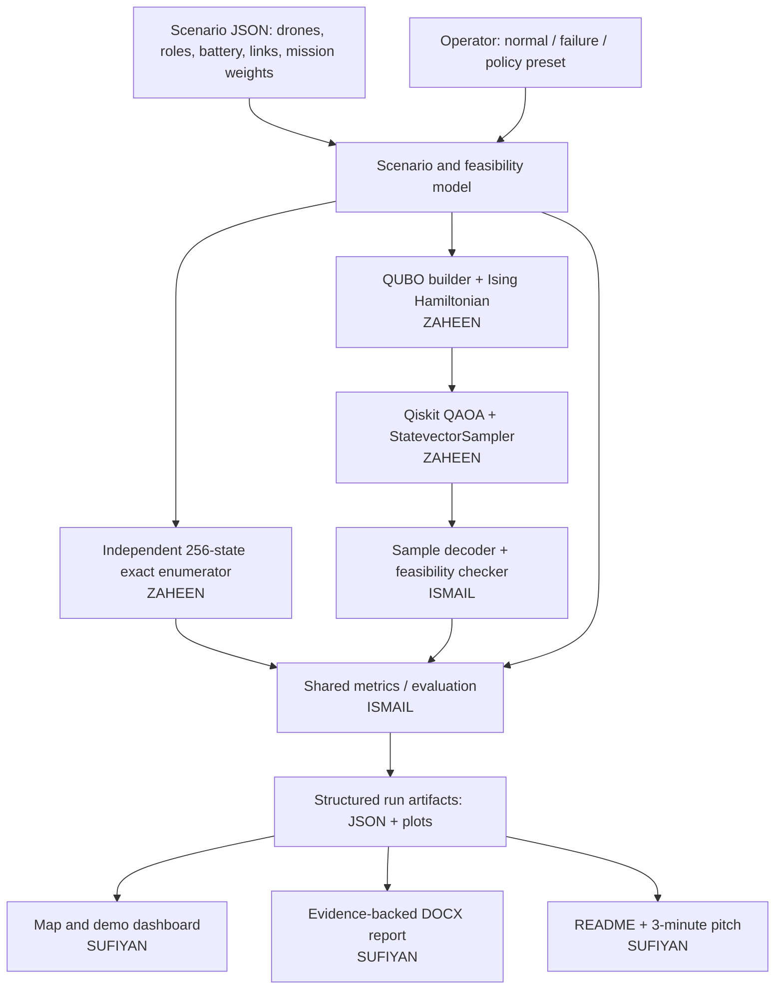

# SKYBRIDGE — Architecture & Technical Specification

**Project:** SkyBridge: Quantum-Assisted Self-Healing Aerial Communications  
**Official hackathon domain:** **1. UAVs & Robotics** (application: disaster response)  
**Status:** Implementation specification; not evidence of a completed system  
**Date / cutoff:** 12 November 2026; submit by **11:59 PM** (verify the organiser's stated timezone)  
**Source of mandatory requirements:** `Qiskit_Hackathon_Optimization.docx` and the supplied event notice.  
**Related plan:** [`work_division.md`](work_division.md)

> **Source versus design:** The hackathon mandates a real Qiskit component, an optimisation formulation, a small test instance, an exact/classical comparison, a DOCX report with an architecture diagram, and a ≤3-minute pitch. The architecture, numerical weights, software tools, APIs and priorities below are *our proposed engineering choices*, not constraints imposed by the organisers.

## 1. Objective and non-negotiable scope (P0)

A disaster disrupts ground communications. Four synthetic radio-equipped drones have limited battery and exclusive duties: temporary **hill relay**, **valley relay**, **reconnaissance**, or **medical supply delivery**. Some ground teams need **both** a hill and a valley relay to connect to the command node. SkyBridge assigns available drones to roles to maximise useful rescue mission value and communication reach, net of energy costs and subject to hard feasibility constraints.

**P0 must demonstrably do all of the following:**
1. Load one fully specified 4-drone / 8-decision synthetic instance with an explicit communication adjacency matrix.
2. Build a real binary QUBO and corresponding Ising cost Hamiltonian from the *same* scenario used for evaluation.
3. Run **QAOA in IBM Qiskit on a local statevector simulator**, obtain measured/sampled bitstrings, and decode a feasible assignment; no hard-coded quantum answer.
4. Independently enumerate the 2^8 = **256 bitstrings** and identify the exact best feasible assignment.
5. Print and save both results, validity, objective breakdown, qubit/shot/depth settings, and optimality gap; distinguish **quantum** from **exact** results.
6. Display a legible diagram or simple UI of drones, radio links, ground team and assignment choices.
7. Reproduce a complete run from a clean clone using documented commands, fixed seeds and pinned, verified dependencies.

**Not in scope:** physical drones, autonomous flight control, live GPS, actual radio links, realistic propagation models, trained rescue triage models, real-world life-critical use, real IBM quantum hardware, or quantum speedup claims.

## 2. Priority-ordered functional capabilities

| Priority | Capability | Required? | Definition of done |
|:--|:--|:--:|:--|
| **P0-A** | Drone-to-role assignment under resource constraints | YES | All role conflicts, one payload, battery and failure masks enforced |
| **P0-B** | Two-hop network-aware link reward | YES | Isolated ground team receives connectivity reward **only** when hill AND one valley relay are assigned |
| **P0-C** | QAOA and exact comparison | YES | Qiskit samples, exact best-feasible result, feasibility and gap displayed and written to JSON |
| **P1** | **Self-Healing Network** | Highest extension | Fail active valley drone B; re-run real optimiser and show how C may replace it; compare before/after |
| **P2** | **Mission Sacrifice Protocol** | Second extension | Three weight presets visibly change mission/connectivity trade-off; actual solver reruns |
| **P3** | **ShadowMap** | Third extension | A shared fixed radio-link/obstacle matrix drives both scoring and the visual map |
| P4 | Predictive handover | If time permits | Discrete battery drain + re-plan before relay must depart; all assumptions labelled |
| P5 | Resilience score | If time permits | Post-evaluation of connectivity under one additional drone loss; not falsely presented as optimised |
| P6 | Ghost Mode / data ferry | Future | Store-carry-forward delay model, **not** part of the 8-variable version |
| P7 | Larger multi-team mesh | Future | More qubits/route variables, explicit path connectivity constraints |

**Scope gate:** P1–P3 must not delay P0, the formal DOCX report, reproducibility, or the video. P4–P7 are documentation-only unless all submission deliverables have passed their checks.

## 3. Architecture diagram



**Data boundary:** The QAOA branch must actually execute a parameterised circuit, use the QUBO-derived Hamiltonian and produce sampled candidates. Only the *feasible, scored* quantum candidates may be labelled as quantum solutions. The exact solver is a separate comparison branch; it cannot be relabelled as quantum or used as an undisclosed fallback.

## 4. Canonical eight binary variables

`x[i] ∈ {0,1}` means the drone takes that single role during the planning snapshot. **Keep this variable order everywhere** (QUBO, qubits, baselines, plots, JSON, tests):

| Index | Drone | Role | Synthetic mission utility `v_i` | Synthetic energy cost `e_i` |
|---:|:---:|---|---:|---:|
| 0 | A | H: hill relay | 1 | 40 |
| 1 | A | N: northern reconnaissance | 8 | 30 |
| 2 | B | V: primary valley relay | 1 | 35 |
| 3 | B | Deliver: medical supplies | 6 | 45 |
| 4 | C | V: alternate valley relay | 1 | 30 |
| 5 | C | E: eastern reconnaissance | 7 | 35 |
| 6 | D | Deliver: emergency supplies | 6 | 40 |
| 7 | D | S: southern reconnaissance | 4 | 25 |

**Synthetic drone battery budgets:** `A=85, B=80, C=60, D=55`; **minimum return/emergency reserve:** `15` energy units. All costs and utilities are illustrative and must be labelled as such. Prohibit any assignment `x_i=1` if `e_i + reserve > battery[drone]`. Never interpret utility as a calibrated number of saved lives.

### 4.1 Hard constraints

- One role per drone (idle permitted): `x0+x1 ≤ 1`, `x2+x3 ≤ 1`, `x4+x5 ≤ 1`, `x6+x7 ≤ 1`.
- One active valley relay position: `x2+x4 ≤ 1` (mutually exclusive valley choices in this simplified model).
- One available delivery payload: `x3+x6 ≤ 1`.
- Battery reserve: any role exceeding available battery minus reserve is forbidden.
- Failure: scenario `relay_failure` disables drone B entirely: **`x2=x3=0`**. Do not secretly introduce an extra drone.
- Communication edges must exist in the supplied adjacency matrix; no visual link may be counted if absent from it.

### 4.2 Connectivity model

Canonical topology: `Base -- H -- V -- Team T`. A drone assigned to H and **exactly one** drone assigned to either V option completes the path (assuming every requisite matrix edge is marked available). The base is assumed functional and the selected roles have suitable radios.

For the base scenario with validated links:

`connected_T(x) = x0 * (x2 + x4)`.

Because `x2+x4 ≤ 1`, this is 0 or 1 for feasible assignments. Do **not** award valley-relay connectivity without the hill relay. A topology variant may disable the B-valley or C-valley link; in that case use validated constants `l_B, l_C ∈ {0,1}`:

`connected_T(x) = x0 * (l_B*x2 + l_C*x4)`.

**This quadratic expression is specific to this two-relay topology.** It does not prove general path connectivity for arbitrary drone meshes.

### 4.3 Objective function and QUBO

For feasible assignments, define useful mission score (maximise):

`U(x) = Σ_i (v_i - α*e_i)*x_i + W*connected_T(x)`.

Base synthetic settings: `α = 0.05` energy-cost multiplier, `W = 22` connected-critical-team bonus. **Concrete preset proposal:** `mission_first W=3`, `balanced W=22`, `coverage_first W=35` (keep all other weights the same initially). These inputs are synthetic parameters, not measured results; the chosen presets are intentionally far enough apart to test different trade-offs using an exact solver. Record every run's weights; do not compare raw utility scores across different preset weights as if they were on the same scale.

Construct the QUBO to minimise:

`E(x) = -U(x) + P*Σ_(i,j in conflict_pairs) x_i*x_j + P*Σ_(i in forbidden) x_i`.

Here `conflict_pairs` contains the four same-drone pairs, `(2,4)` for the valley slot and `(3,6)` for the payload. `forbidden` reflects battery and failure masks. Choose and test a positive penalty `P` conservatively larger than the largest possible utility advantage from violating a constraint, e.g. `P > Σ_i |v_i-αe_i| + W + 1` for this instance; log the chosen value. Do **not** enforce feasibility by adding a penalty only in the UI.

Map to an Ising cost operator via `x_i=(I-Z_i)/2` and expand the constant, local `Z_i` and two-body `Z_i Z_j` terms; use a documented qubit/bitstring ordering and separately preserve the constant energy offset. Create the actual Hamiltonian with `qiskit.quantum_info.SparsePauliOp`.

**Correctness tests:** For **all 256 states**, check that the evaluated diagonal Hamiltonian + offset agrees (to numerical tolerance) with the quadratic QUBO energy, and that the original constraints correctly reject invalid states. If a conversion library is used, cross-check it against the direct QUBO evaluator.

## 5. Algorithmic stack and execution strategy

| Layer | Proposed technology | Rationale |
|---|---|---|
| Language | Python 3.11 | Broad Qiskit and testing support |
| Quantum SDK | **Qiskit 2.x**, `qiskit-algorithms` compatible release (e.g. 0.4.x) | Actual QAOA / Hamiltonian tooling |
| Simulator | `qiskit.primitives.StatevectorSampler` | No IBM account, queue, or real hardware needed |
| Quantum method | QAOA `reps=1` to start | Simple 8-qubit approximate binary optimiser |
| Parameter optimiser | COBYLA, initial `maxiter=60–100` | Classical outer-loop optimisation |
| Numerical | NumPy, SciPy | Matrix and parameter optimisation |
| Graph/network | Python standard library (or NetworkX only if useful) | Explicit topology and reachability |
| Data | Dataclasses / JSON | Single scenario and results contract |
| UI | Streamlit **only after CLI works**, or a matplotlib diagram | Presentable 3-minute walkthrough |
| Tests | pytest | Constraint, QUBO, decoder, smoke tests |
| Report | python-docx / editable Word document | Required `.docx`, with architecture image and measured outputs |

**Suggested P0 parameters:** `p=1`, `shots=1024` or `2048`, `seed=42`, `COBYLA maxiter=80`. These are experiment configurations, **not predetermined successful results**. If QAOA is unstable, document 2–3 seeds or vary `p` subject to available compute time. Pin the exact working dependency versions in `requirements.txt`/`pip freeze` only after a clean local installation.

Reference APIs (verify against the installed versions rather than assuming old tutorial syntax):
- IBM QAOA tutorial: https://quantum.cloud.ibm.com/docs/en/tutorials/quantum-approximate-optimization-algorithm
- Qiskit Algorithms QAOA: https://qiskit-community.github.io/qiskit-algorithms/stubs/qiskit_algorithms.QAOA.html
- SDK local primitives: https://quantum.cloud.ibm.com/docs/en/qiskit/simulate-with-qiskit-sdk-primitives

Avoid creating a new dependency on the archived `qiskit-optimization` project unless compatibility is established and credited.

## 6. Module and interface contracts

**MANDATORY canonical repository tree** — exact names, casing, and locations are contractual. Items marked `optional` are permitted only at the shown paths; artifacts are produced by real runs and must not be fabricated:

```text
skybridge/
├── README.md
├── requirements.txt
├── architecture.md
├── work_division.md
├── app.py                    # OPTIONAL: Sufiyan UI, only after headless CLI works
├── run.py                    # Ismail: headless orchestration
├── src/
│   ├── scenario.py          # Ismail: scenario dataclasses & presets
│   ├── network.py           # Ismail: edge matrix / reachability
│   ├── model.py             # Zaheen: QUBO/Hamiltonian construction
│   ├── quantum.py           # Zaheen: QAOA simulator and sampling
│   ├── baseline.py          # Zaheen: exhaustive exact solver
│   ├── evaluate.py          # Ismail: hard constraints, utility, metrics
│   └── pipeline.py          # Ismail: common run orchestration / JSON output
├── data/
│   ├── base.json
│   ├── relay_failure.json  # OPTIONAL until P1
│   └── policy_presets.json  # OPTIONAL until P2
├── tests/
│   ├── test_model.py        # Zaheen
│   ├── test_exact.py        # Zaheen
│   ├── test_network.py      # Ismail
│   ├── test_constraints.py  # Ismail
│   └── test_pipeline.py     # Sufiyan + Ismail
├── scripts/
│   ├── bootstrap_structure.py # Sufiyan: create directories safely
│   ├── verify_structure.py    # Sufiyan: enforce this tree
│   ├── generate_report.py   # Sufiyan: based ONLY on real artifacts
│   └── verify_submission.py # Sufiyan
├── .skybridge-phase         # scaffold / implementation / submission
├── .github/workflows/structure.yml  # CI structure gate
├── artifacts/               # real run output; no fabricated data
│   ├── runs/*.json          # generated from real solver runs
│   ├── figures/*.png        # actual diagram/figures
│   └── COMPLETION_REPORT.md
└── report/
    └── SkyBridge_Hackathon_Report.docx # required at submission
```

### 6.1 Repository layout is **enforced, not advisory**

The tree above is the single canonical layout. **All three developers and all coding agents MUST comply**; no renaming, flattening `src/`, moving tests, creating a competing `backend/` or `quantum/` package, or putting outputs at repository root. A change to any canonical location requires explicit agreement from **all three** owners, synchronised updates to both Markdown specifications, the structural verifier and CI, and a recorded change note in `artifacts/COMPLETION_REPORT.md`. Optional P1–P3 modules use the exact locations above **if implemented**, but are not P0 delivery requirements. The `.gitkeep` files created by bootstrap merely preserve empty directories; they are not evidence of feature completion.

**Enforcement commands, from repository root:**

```bash
python scripts/bootstrap_structure.py    # one-time, non-destructive directory setup
python scripts/verify_structure.py --phase scaffold --strict
python scripts/verify_structure.py --phase implementation --strict
python scripts/verify_structure.py --phase submission --strict
```

- `scaffold` checks the approved directories, governing Markdown files, enforcement scripts and CI configuration.
- `implementation` adds mandatory P0 source modules, tests, initial scenario, CLI entry point, `README.md` and dependencies. Run this after the P0 merge. UI (`app.py`) and optional extension scenario JSONs are **not** required to pass this phase.
- `submission` additionally requires a genuine run JSON, populated completion report, architecture figure and `report/SkyBridge_Hackathon_Report.docx` plus report/submission scripts. Structural compliance alone **does not** prove computation succeeded or links work; execute the functional tests and submission checks too.
- `--strict` rejects unapproved **top-level** folders/files and disallowed file types in the canonical source, test and data directories. Additional utility source files are allowed inside `src/` only if they honour the documented contracts; no duplicate implementation may shadow the canonical module.
- `.skybridge-phase` contains exactly one of `scaffold`, `implementation`, `submission`. CI runs the verifier against this declared phase; promote to `implementation` when P0 lands and to `submission` before the final submission. **Do not leave phase set to `scaffold` for the release commit.**
- `.github/workflows/structure.yml` must run the verifier for every pull request and push; make its check a required GitHub branch-protection status before merges when permissions permit. This is a CI gate, not just a written instruction. An AI agent MUST run the verifier and record its output in the completion report before claiming its work is finished.

**Rule for violations:** if the checker fails, correct file locations first; do not weaken or bypass the checker merely to make CI green. No owner should merge a non-conforming file structure.

**Required signatures / semantics** (names may change only by a coordinated team decision):

```python
load_scenario(name: str, policy: str = "balanced") -> Scenario
is_feasible(bits: tuple[int, ...], scenario: Scenario) -> bool
score_feasible(bits: tuple[int, ...], scenario: Scenario) -> dict
build_qubo(scenario: Scenario) -> QuboSpec  # linear, quadratic, offset, ordering, penalty
build_hamiltonian(qubo: QuboSpec) -> HamiltonianSpec
solve_exact(scenario: Scenario) -> ExactResult
solve_qaoa(qubo: QuboSpec, *, seed: int, shots: int, reps: int, maxiter: int) -> QuantumResult
run_scenario(name: str, policy: str, seed: int = 42) -> dict
```

`solve_exact` must independently use `is_feasible` and `score_feasible`, **not** infer the answer from QAOA bitstrings or its `QuboSpec` energies. For ties, use a specified deterministic bitstring tie-breaker. Use one shared feasible-score implementation when comparing quantum and exact results.

**Bit convention:** Store logical bits as a length-8 array indexed `[x0..x7]`. At Qiskit boundaries explicitly reverse the printed bitstring when necessary to account for `q0` being the least-significant bit; test known basis states (e.g. only x0=1, only x7=1).

## 7. Experiment scenarios and results contract

| ID | Change | Required assertions |
|---|---|---|
| `base` | All four drones available | At most one role each, unique valley, at most one delivery, valid reachability |
| `relay_failure` | B disabled (x2=x3=0) | Failure mask respected; show connectivity before failure, immediate loss, and reoptimised state |
| `policy_coverage` | Increase W relative to mission weights | Re-solve; show connected team count and actual abandoned task (if any) |
| `policy_mission` | Reduce W relative to mission weights | Re-solve; demonstrate a different trade-off if data supports it |
| `shadow_block` (P3) | Disable an edge/relay option in matrix | Connectivity scoring and drawn links change consistently |

A *scenario* is a different optimisation instance. It is valid if it returns a different feasible plan; do not hard-code expected algorithm outputs for a stochastic solver. To demonstrate dramatic differences, tune synthetic scenario *inputs*, then let both solvers independently compute the results.

Save one structured record per run:

```json
{
  "scenario": "base",
  "seed": 42,
  "model": {"n_binary": 8, "penalty": null, "weights": {}, "role_order": []},
  "quantum": {"ran_qiskit": false, "best_feasible_bits": null, "utility": null,
              "feasible_sample_fraction": null, "shots": null, "qaoa_reps": null,
              "optimizer_iterations": null, "elapsed_seconds": null},
  "exact": {"best_bits": null, "utility": null, "enumerated_states": 256,
            "elapsed_seconds": null},
  "comparison": {"absolute_gap": null, "relative_gap_pct": null},
  "constraint_checks": {}, "software_versions": {}, "notes": []
}
```

This is a **schema example with null placeholders**, not a completed result. When the code runs, write genuine values (including cases of no feasible quantum sample), plus objective component breakdown and counts. Consider `relative_gap_pct = 100*(U_exact-U_quantum)/abs(U_exact)` **only if** the baseline's objective is nonzero and the interpretation is meaningful; otherwise use `null` and explain.

**Minimum tests to pass:**
- 256-state QUBO vs. diagonal Ising energy equality; no wrong sign or endian conversion.
- Every sampled assignment satisfies all hard constraints before being labelled feasible.
- Baseline evaluates all 256 original bitstrings; exact feasible optimum maximises the specified utility.
- Connectivity is false for `x0=0` or `x2=x4=0` and true for feasible `x0=1` with precisely one valid valley relay.
- Failure B forces both `x2=x3=0`.
- Change in adjacency blocks the associated relay path; UI reads the same data.
- At least one end-to-end **real Qiskit** run yields a stored reproducible trace (if no feasible sample, record failure honestly and improve sampler/penalties).
- Clean-clone reproduction on another terminal/environment.

## 8. Build sequence and integration gates

1. **Contracts locked:** Ismail supplies scenario JSON and evaluator; Zaheen confirms bit ordering and QUBO interface.
2. **Mathematics proved:** Zaheen constructs QUBO/Ising with exhaustive state-energy comparison and exact optimum; do not begin a polished UI before this checkpoint.
3. **Real QAOA executed:** Zaheen runs local Qiskit sampler; Ismail integrates feasible decoding and produces actual JSON artifacts.
4. **P0 smoke test:** Sufiyan follows the README from a fresh venv, checks metrics and diagram against the JSON evidence.
5. **P1 then P2 then P3:** Add in that order **only after P0 passes**; rerun exact and quantum on every new scenario.
6. **Deliverables:** Generate architecture graphic + DOCX report, capture live demo, publish GitHub link, validate accessibility and submit before deadline. Do **not** commit after cutoff.

## 9. Mandatory AI-assisted status and final reporting

**Instruction to every coding AI and every team member:** After each assigned work package, **update `artifacts/COMPLETION_REPORT.md`** using the following exact headings:

```markdown
# Completion Report — SkyBridge
- As of (date/time + timezone):
- Owner / agent:
- Branch / commit SHA:
## Completed and evidenced
| Requirement / feature | Files changed | Verification command | Actual outcome |
## Results measured (link actual artifacts)
## Tests run (command, pass/fail counts, logs)
## Known defects and unresolved dependencies
## Not implemented / deferred features
## Assumptions and limitations
## Next owner / actionable handoff
## Source attribution (if any code reused)
```

Do **not** treat a status report, passing unit tests, or a dashboard screenshot as evidence of quantum optimisation unless a genuine Qiskit circuit was run. If a feature is incomplete, mark it incomplete; **never invent results, filenames, measured scores, speedups, paper citations, or demo footage**. The report generator must read actual saved results rather than generate imaginary examples. Clearly differentiate source requirements, proposed assumptions, and observed results.

The separate **hackathon DOCX report** must include title/team/date; problem/users; objectives and constraints; 4-drone/8-variable instance; choice/justification of QAOA and circuit/Hamiltonian; architecture diagram; experiment setup (versions, seeds, shots, p, optimizer); a *real* quantum-versus-exact results table; discussion of infeasibility/gaps; limitations; original/reused code credits; and reproduction instructions. If the quantum run failed, report the failure honestly instead of substituting the baseline result.

## 10. Submission compliance (organiser requirements)

- [ ] Exactly **one eligible domain**, labelled **UAVs & Robotics**.
- [ ] Concrete users/problem, variables, measurable objectives, hard constraints, at least one small test instance.
- [ ] Genuine quantum computation implemented in Qiskit, with a justified QAOA mapping.
- [ ] Exact/classical/analytical baseline and reproducibility evidence.
- [ ] **Public GitHub repository URL** with working code and README setup/run/test instructions.
- [ ] **DOCX report** with architecture diagram, real measured comparison and honest limitations.
- [ ] **Video pitch/demo ≤ 3:00**, accessible via Google Drive or equivalent **anyone-with-link** permissions.
- [ ] Final commit **before 12 Nov 2026 11:59 PM**; **no commits after the deadline**.
- [ ] Test every submitted link, including the repository and video, while signed out/incognito.
- [ ] Submit via organiser form: https://forms.gle/jSRrXaHkjVb7G7AK8

**Rubric focus:** problem validity 20; meaningful quantum usage 25; implementation/validation 25; innovation/originality 15; presentation/defence 15. **Optimisation and validation are worth 70 points together with problem validity; prioritise those over extra frontend effects.**

## 11. Research/code provenance

Use original team-owned code for the mathematical instance, model, QAOA pipeline and evaluation. Any copied/reused code must be credited explicitly per the event instructions. The Qiskit guides linked above are references, not permission to submit a copied tutorial as an original project. Source brief and earlier SkyBridge specification are local user-provided documents; the numerical design in this file is our proposed synthetic implementation plan.
